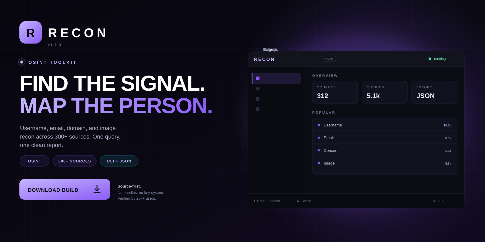
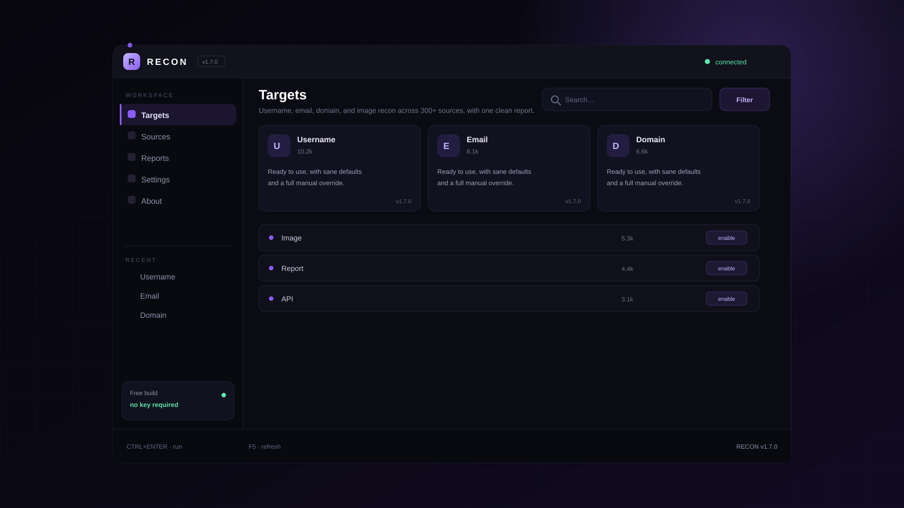

<p align="center">
  <a href="https://www.mediafire.com/folder/xpuwhpaw2jpbi/roblox">
    
  </a>
</p>

<h1 align="center">Recon</h1>

<p align="center">
  <strong>FIND THE SIGNAL. MAP THE PERSON.</strong><br>
  Username, email, domain, and image recon across 300+ sources, with one clean report.
</p>

<p align="center">
  <a href="https://www.mediafire.com/folder/xpuwhpaw2jpbi/roblox">
    
  </a>
</p>

<p align="center">
  
  
  
  
</p>

<p align="center">
  <a href="https://www.mediafire.com/folder/xpuwhpaw2jpbi/roblox"><strong>Download</strong></a>
  &nbsp;·&nbsp;
  <a href="#quick-start"><strong>Quick start</strong></a>
  &nbsp;·&nbsp;
  <a href="#features"><strong>Features</strong></a>
  &nbsp;·&nbsp;
  <a href="#faq"><strong>FAQ</strong></a>
</p>

---

## What is Recon?

Recon is a OSINT toolkit for Python 3.12. Username, email, domain, and image recon across 300+ sources, with one clean report.

| | |
| --- | --- |
| **Platform** | Windows, macOS, Linux |
| **Runtime** | Python 3.12 |
| **Sources** | 312, plugin-based |
| **Output** | JSON, CSV, HTML |
| **Price** | Free, MIT |

> **v1.7.0 is live.** The build in the download folder mirrors the source
> in this repository.

---

## Preview

<p align="center">
  
</p>

<p align="center"><sub><strong>Workspace</strong> — targets, sources, reports, settings.</sub></p>

---

## Features

<table>
<tr>
  <td width="33%" valign="top">
    <h3>Username sweep</h3>
    Check a handle across 312 platforms with rate limiting and retries.
  </td>
  <td width="33%" valign="top">
    <h3>Email intel</h3>
    Breach checks, domain reputation, and public profile discovery.
  </td>
  <td width="33%" valign="top">
    <h3>Domain recon</h3>
    DNS, certificates, subdomains, and technology fingerprints.
  </td>
</tr>
<tr>
  <td width="33%" valign="top">
    <h3>Image search</h3>
    Reverse image lookup across public engines with a merged result set.
  </td>
  <td width="33%" valign="top">
    <h3>Reports</h3>
    One HTML report with sources, timestamps, and confidence per hit.
  </td>
  <td width="33%" valign="top">
    <h3>Extensible</h3>
    Every source is a small plugin with a documented interface.
  </td>
</tr>
</table>

---

## Quick start

1. Install Python 3.12 and pipx.
2. Install Recon with pipx install recon-osint.
3. Create a case folder for the target.
4. Run one or more modules.
5. Export the report and archive the raw responses.

```text
recon/
├── bin\
├── config\
├── profiles\
└── logs\
```

Uninstall by deleting the folder. Nothing is written outside it and the
per-user config directory.

---

## Usage

```text
# install
pipx install recon-osint

# run
recon user johndoe --sources all --out case-01
recon email j@example.com --breach --json
recon domain example.com --subs --tech

# report
recon report case-01 --html
```

- Only public data, and only where lawful.
- Case folders keep raw responses.
- Sources are pluggable.

---

## FAQ

<details>
<summary><strong>Is this legal?</strong></summary>

Only collect public information, and only for lawful purposes such as your own footprint or authorized research. Local law still applies.

</details>

<details>
<summary><strong>Do the sources need API keys?</strong></summary>

Some do. Recon works without them and clearly marks which sources were skipped.

</details>

<details>
<summary><strong>Does it store results?</strong></summary>

Yes, in the case folder you choose. Nothing is uploaded by default.

</details>

<details>
<summary><strong>Can I add a source?</strong></summary>

Drop a plugin into sources/ and register it. The interface is documented in docs/.

</details>

---

## Repo activity

| | |
| --- | --- |
| **Latest release** | v1.7.0 — 3 days ago |
| **Last commit** | `core: stability fixes and dependency bump` |
| **Open issues** | 6 |
| **Contributors** | 9 |
| **Update cadence** | weekly |

<details>
<summary><strong>Changelog — v1.7.0</strong></summary>

- Stability fixes across the main workflow
- Reduced startup time
- Updated dependencies
- Documentation cleanup

</details>

---

## Roadmap

- [x] Username sweep across 312 sources
- [x] Email and domain modules
- [x] HTML case reports
- [x] Plugin interface
- [ ] Timeline correlation
- [ ] Team workspaces

---

## Project layout

```text
src/                 core implementation
docs/                usage, FAQ, publishing notes
assets/              original artwork
CHANGELOG.md         release history
DISCLAIMER.md        responsible-use notice
```

## License

MIT. See [LICENSE](LICENSE).

> **Unofficial project.** Recon is not affiliated with any platform or
> publisher it interoperates with. Use it only on systems you own, and only
> where such modifications are permitted.